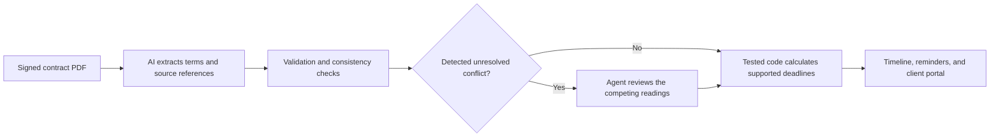
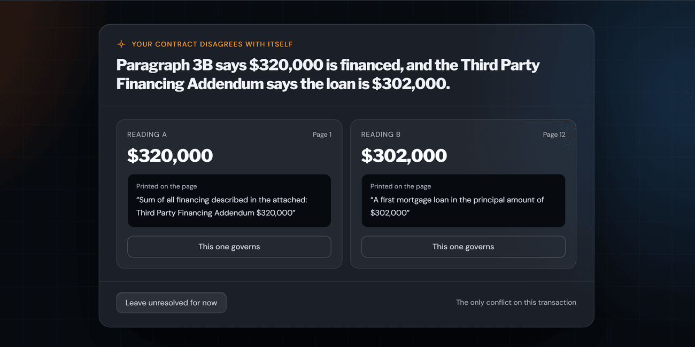

# CloseTraq: from signed contract to deadline timeline

I'm Brad Claus, a Texas real estate agent. I built CloseTraq to turn signed residential contracts into deadline timelines agents can review. It uses AI to extract contract terms, tested TypeScript functions to calculate dates, and an agent review step when it detects conflicting values.

[Live product](https://www.closetraq.com) | [Walkthrough](https://youtu.be/9qcjHhWRpwc) | [LinkedIn](https://www.linkedin.com/in/bradley-claus-91942946)

I defined the workflow and contract rules, labeled the evaluation contracts by hand, and used the results to compare extraction approaches. I checked the product with contract uploads, amendments, and the payment flow, and decided what needed to change. I used Claude Code extensively to write and revise application code and automated tests.

**CloseTraq is live in production.** The application handles signed contracts and sensitive transaction information, so this public repository presents the product decisions and evaluation method using fictional examples. The production application and its source code remain proprietary; client documents, production data, and private configuration are excluded.

The application is hosted on Vercel and uses Supabase for its data; the private codebase is managed in GitHub. This case study focuses on the decisions behind the product and how I checked its behavior.

## The problem

A signed Texas residential contract contains deadlines with different starting points, cutoff times, and extension rules. Some count from the Effective Date, others from the title company's receipt of the contract, and some count backward from closing. Applying the same rule to all of them produces the wrong timeline.

The documents also arrive scanned, partly handwritten, and corrected on the page. In my 16-contract evaluation set, seven contracts contained conflicting or corrected information that needed attention. That made handling uncertainty part of the workflow from the start.

## How it works

The application sends the PDF directly to a model and checks the extracted fields against required formats and business rules. Extracted values carry source wording and page references so the agent can check them against the document. Date calculations run in code, separately from extraction.

When the system detects competing readings, it shows them to the agent and withholds affected deadlines until the conflict is resolved. Apparent strike-through corrections follow a separate rule: the replacement value is used with a visible notice, while ambiguous checkbox selections remain conflicts.

The completed timeline supports agent email and text reminders, a client portal, and client email reminders. Amendments update the timeline.

*The agent sees both extracted values and the source wording before recording a choice.*

## Evaluation results

These results come from a 16-contract evaluation set.

| Measure | Result | Scope |
| --- | --- | --- |
| Detection of previously labeled contradictions | OpenAI: 6 of 6; Anthropic: 5 of 6 | Six contradictions labeled before model-assisted additions to the answer key |
| Mean extraction cost per contract | $0.27–$0.31 | Runs on 16 contracts averaging 16.6 pages, September–October 2026 |
| Mean extraction time | 42 seconds | September 2026 run on the same 16-contract set |

The evaluation distinguishes extracted-field accuracy, calculated-deadline accuracy, and contradiction detection. The set is small, and I revised parts of the answer key after checking model findings against the documents. I explain those limits in [evaluation results and limits](decisions/4-evaluation-results-and-limits.md), with the scoring method in [evaluation/](evaluation/).

## Decisions that shaped the product

- **Separate extraction from date calculation.** The model reads contract terms; TypeScript functions apply the supported timing rules. Tests cover daylight saving time, property time zones, cutoff times, and rule-specific holiday handling.
- **Keep evidence next to the result.** Source wording and page references give the agent a way to check a value. They are review aids, and still need to be verified against the PDF.
- **Make detected conflicts visible.** The agent sees the competing readings and reviews the affected values before the timeline uses them. [Conflict review](decisions/2-reviewing-conflicts.md)
- **Test the document pipeline as well as the model.** Sending PDFs directly improved deadline scores for both providers in my comparison, so I removed the separate OCR step. [The OCR comparison](decisions/1-dropping-ocr.md)
- **Name fields by meaning.** Contract form layouts and paragraph numbers change. Field names describe the information being extracted, with form versions retained for reference. [Meaning, not paragraph numbers](decisions/3-meaning-not-paragraph-numbers.md)

## My role and the build

I launched the first version on Bubble in June 2026. I began the rewrite in August to move date calculations into tested code and gain more control over the design. The rewritten product went live on September 23, 2026.

My work included translating an agent's contract-review workflow into product requirements, defining review and exception handling, and comparing extraction approaches. I checked uploads, amendments, payments, and timeline behavior from an agent's perspective. Automated checks for contract timing rules supported that hands-on review and the release decisions.

## Explore the repository

| Folder | Contents |
| --- | --- |
| [decisions/](decisions/) | Four short accounts of the choices and tradeoffs behind the product |
| [evaluation/](evaluation/) | Scoring method and a fictional worked example |
| [images/](images/) | A product screenshot using fictional demonstration data |

This repository contains documentation and a demonstration screenshot. Application source code, extraction prompts, database definitions, and test tooling are kept private. Agents still need to verify the timeline against the signed documents.

Case-study text and screenshots © 2026 Brad Claus. All rights reserved.
