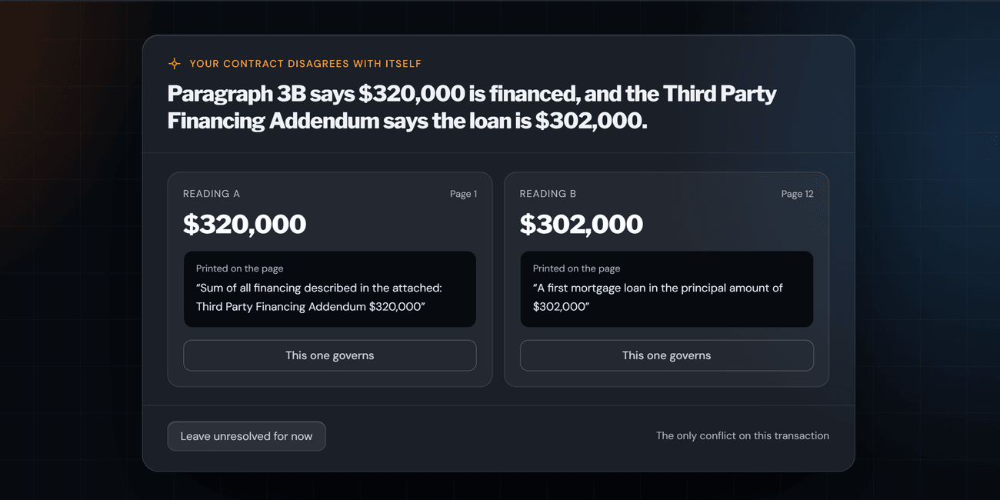

# Keeping detected conflicts in the agent's review

**Decision, September 2026:** when the system detects competing contract values, show the readings and their source wording, and withhold affected deadlines until the agent resolves the conflict.

## Why this matters

A single value in a timeline can look authoritative even when the document contains two different answers. I wanted the agent to see that disagreement before relying on the affected deadline.

## What I found in the evaluation set

Seven of the 16 contracts contained conflicting or corrected information that needed attention. Examples included incompatible checkbox selections, rewritten values, and differences between the contract and receipt information.

For the detection benchmark, I use the six contradictions labeled before model-assisted additions to the answer key. OpenAI detected 6 of 6 and Anthropic detected 5 of 6. Those counts describe this small test set, not a guarantee that the system finds every conflict.

## Making the review useful

I designed the review step to show the alternatives and their source wording together. The agent can compare them against the document before choosing the value used for the timeline.

Some consistency checks run in code. For example, code compares the financed amount in the contract with loan amounts in the financing addendum and flags a mismatch.

## Treating apparent corrections separately

Initially, every strike-through went to the agent as a conflict. In October 2026, I narrowed that rule: an apparent replacement of a number, date, or written value uses the replacement and displays a correction notice. Ambiguous checkbox selections remain conflicts, as do disagreements between the replacement and other documents.

In the reviewed number and date cases, both providers identified the intended replacement; the ambiguity appeared in a checkbox case. That supported treating the cases differently, while keeping a visible correction notice and the agent's review.

The notice makes the correction visible. It does not establish that an alteration is legally effective, and the agent still needs to check the document.
